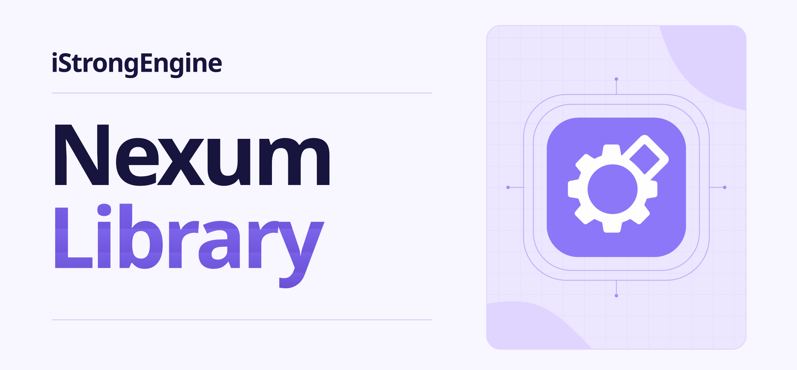

<p align="center">
  
</p>

<h1 align="center">Nexum Library</h1>

<p align="center">
  Convert tanks between arras code and iStrongEngine, right in your browser.
</p>

<p align="center">
  <a href="https://istrongnexum.pages.dev"><b>Open Nexum</b></a>
  &nbsp;|&nbsp;
  <a href="https://github.com/Arjuna618/iStrongEngine"><b>iStrongEngine</b></a>
  &nbsp;|&nbsp;
  <a href="https://discord.gg/HTE9MTsmBm"><b>Discord</b></a>
</p>

<p align="center">
  I support arras.io and its devs. Go play their game at <a href="https://arras.io">arras.io</a>
</p>

## What it does

Nexum is the bridge between arras style tank code and iStrongEngine.

* **Class code, both ways.** Paste arras class code and get iStrongEngine tanks, or turn an iStrongEngine tank back into class code.
* **Open Source Arras addons.** Turn an OSA addon into iStrongEngine tanks, or pack iStrongEngine tanks into an OSA addon.
* **The library.** Browse 2823 tanks, 857 turrets, 133 projectiles, 292 food shapes and 31 other objects, all ready to use.
* **The source code.** Read every file of Nexum inside the app, or download it all as one zip.

## Run it yourself

You need Node.js 20 or newer. The app lives in the NexumDeploy folder and uses the converter in the NexumLibrary folder beside it.

```
cd NexumDeploy
npm install
npm run dev
```

Then open the address it prints. For a production build:

```
npm run build
npm run preview
```

## License

Free to use, to learn from and to teach with. Not for commercial use. The full text is in [LICENSE](LICENSE), and the terms are in [TERMS.md](TERMS.md).

## Credits

Nexum works with [Open Source Arras](https://github.com/open-source-arras/open-source-arras). Its license and the other libraries are listed in [NexumDeploy/legal](NexumDeploy/legal) and [NexumDeploy/public/THIRD-PARTY-NOTICES.txt](NexumDeploy/public/THIRD-PARTY-NOTICES.txt).

Nexum is an independent project. It is not affiliated with, sponsored by, or endorsed by arras.io or its developers.

Made by [Arjuna](https://github.com/Arjuna618), the creator of [iStrongEngine](https://github.com/Arjuna618/iStrongEngine).
